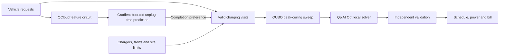

# Qaunfleets

EV fleet charging under departure deadlines and site power limits. QCloud-derived predictions inform completion preferences; QpiAI Opt selects charger and time allocations. The dashboard shows the plan, tariffs, loading, bill and validation.

## Run

Requires Python 3.12 and [uv](https://docs.astral.sh/uv/).

```sh
uv sync --locked
uv run planner_server.py --port 8767
```

Open http://127.0.0.1:8767. Recorded execution is available without credentials. For live execution, copy `.env.example` to `.env` and supply your QpiAI keys. Authentication may require network access; computation runs locally. The server binds to localhost.

Website solve and replay requests save their inputs and matching execution evidence as text files in [`artifacts/run_logs/`](artifacts/run_logs/README.md). A reviewed local SDK run is included as [submission evidence](artifacts/run_logs/submission_qpiai_local.txt).

## Architecture



QCloud executes a fixed six-qubit RY/RZ/CX circuit with 512 shots per request on `QpiAI-QSV-Local`. Six Z and six ZZ measurements feed histogram gradient-boosted regressors for the typical and 10th-percentile unplug-time offset. Confirmed departures are mandatory; the prediction adds an earlier completion preference.

The scheduler generates energy-complete visits that respect arrivals, departures, charger compatibility and power limits. Up to four alternatives per vehicle enter the QUBO. QpiAI Opt uses local simulated annealing; accepted plans pass separate physical and financial checks.

| Module                               | Responsibility                          |
| ------------------------------------ | --------------------------------------- |
| `product_pipeline.py`                | Prediction and scheduling orchestration |
| `qcloud_inference_worker.py`         | Quantum feature measurements            |
| `scheduler.py` / `qubo_scheduler.py` | Charging visits and QUBO formulation    |
| `opt_backend.py`                     | QpiAI Opt execution                     |
| `depot_reference.py`                 | Independent validation                  |
| `planner_server.py` / `static/`      | Local API and dashboard                 |

## Formulation

For peak ceiling $B$, binary variable $x_k$ selects charging visit $k$:

$$
\begin{aligned}
E_B(x,s) ={}& \sum_k c_k x_k \\
&+ A\sum_v\left(\sum_{k\in\mathcal K_v}x_k-1\right)^2 \\
&+ A\sum_{(k,l)\in\mathcal C}x_kx_l \\
&+ A\sum_t\left(\sum_k w_{kt}x_k+s_t-K_t(B)\right)^2.
\end{aligned}
$$

The terms represent visit cost, exactly one visit per vehicle, charger conflicts and shared power capacity. $c_k$ includes tariff cost and completion preference; $w_{kt}$ is charging power in integer units; $s_t$ is unused capacity. $K_t(B)$ is the available integer capacity after background load, bounded by the feeder limit and $B$. Penalty $A$ exceeds the upper bound on feasible visit costs. Invalid outputs are rejected.

Valid plans are compared using:

```math
\begin{aligned}
J ={}& \underbrace{\sum_t \tau_t P_{\mathrm{EV},t}\Delta t}_{\text{energy charge}} \\
&+ \underbrace{r\left[\max(H,P_{\mathrm{site}}^{\max})-\max(H,P_{\mathrm{base}}^{\max})\right]}_{\text{incremental demand charge}} \\
&+ \underbrace{\lambda\sum_v\max(0,f_v-\tilde d_v)}_{\text{completion preference}}.
\end{aligned}
```

Here $\tau_t$ is the tariff, $r$ the demand rate, $H$ the historical peak, $f_v$ the selected finish time and $\tilde d_v$ the preferred finish time in hours. The preference is excluded from the electricity bill. Battery energy is $E_v=\eta\sum_t p_{v,t}\Delta t$, with efficiency $\eta$.

## Validation and scope

```sh
uv run pytest
uv run python -m tools.verify_qubo
uv run python -m tools.verify_shipping
uv run ruff check .
uv run ruff format --check .
```

The supplied depot scenarios are synthetic. The predictor uses NREL workplace-session data; unplugging is a departure proxy, and fleet generalization remains unvalidated. Raw sessions are excluded. See [model details](docs/MODELS.md) and [validation](docs/VALIDATION.md).

We also conducted preliminary research on trainable quantum models, input preprocessing, and matched classical comparisons. Methods, findings, limitations, and local QpiAI SDK outputs are documented in [`research/`](research/).

Initial plans use one contiguous visit per vehicle. Slot-boundary execution events freeze delivered energy and past allocations, then replan remaining energy on the future horizon. Early departures report actual shortfalls; occupied bays block charger reuse; load changes update future headroom. A disrupted visit may resume later. See [operating assumptions](docs/ASSUMPTIONS.md). Execution uses a quantum simulator and a classical QUBO solver; no physical-hardware or quantum-advantage claim is made.

## License and credits

Original code is **AGPL-3.0-only**; see [LICENSE](LICENSE). Modified network-accessible versions must meet its corresponding-source obligations. Third-party licenses remain in [THIRD_PARTY_NOTICES.md](THIRD_PARTY_NOTICES.md).

Built with **QpiAI QCloud** for circuit simulation and **QpiAI Opt** for QUBO solving, alongside scikit-learn, SciPy/HiGHS, Three.js and Apache ECharts. Depot and vehicle geometry are generated by the project.
